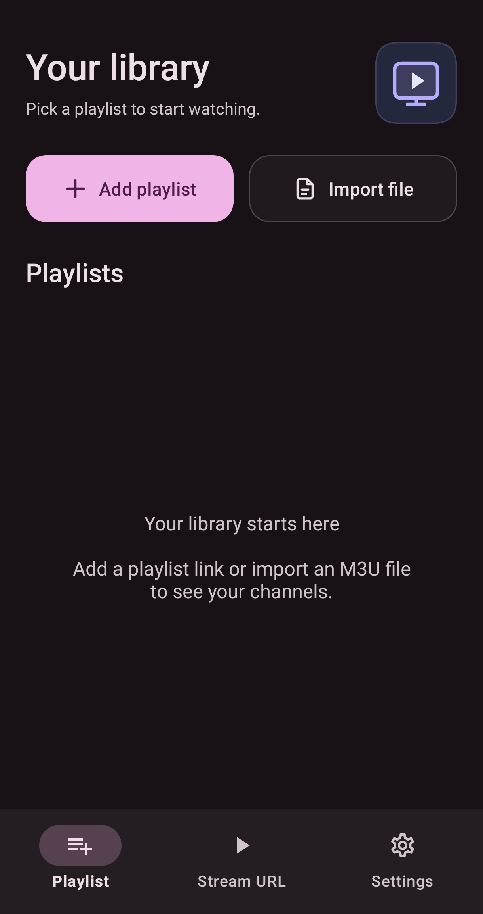
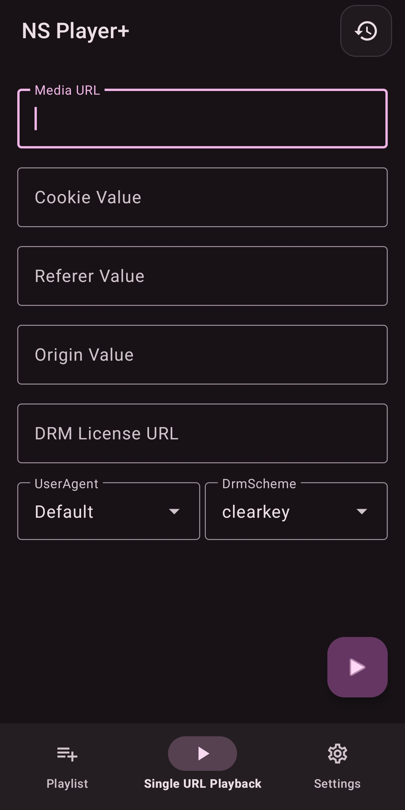
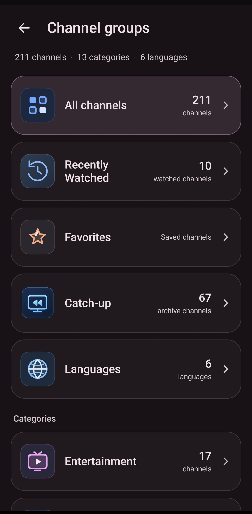
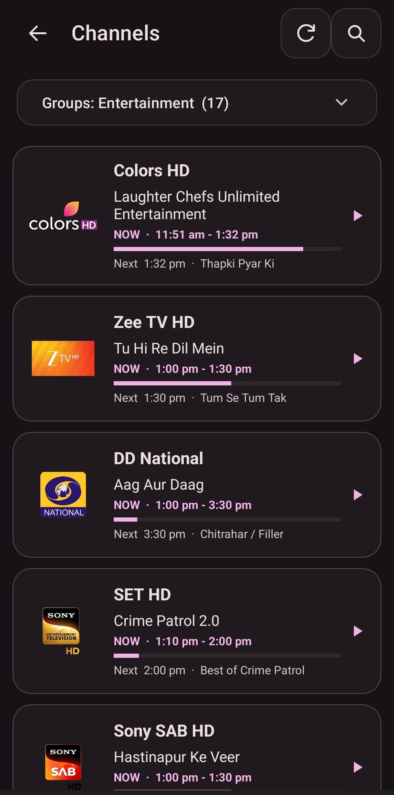
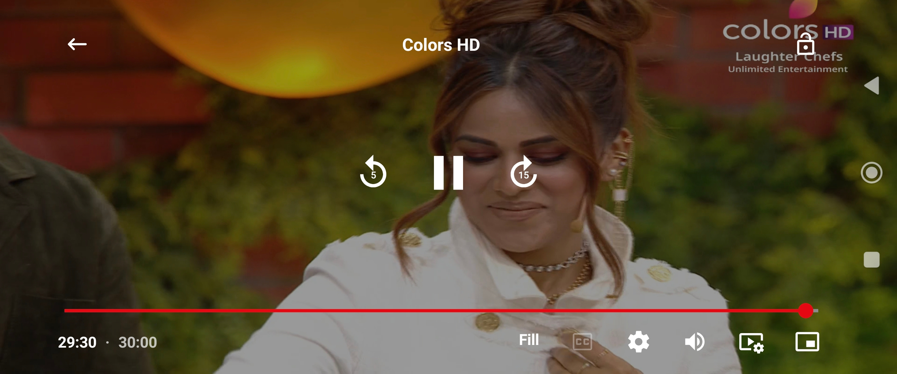

# NS Player+

### A Modern Online Media Player with **0 Ads**

HLS • DASH • ClearKey • Widevine • EPG • Catch-up • Netflix-style UI

 

 

---

## ⚡ NS Player+ Mobile [ Ads Free ] ⚡

**NS Player+** is a fast, clean and fully ad-free online media player built for Android mobile. Add your IPTV playlist, import M3U files, or paste any single stream link and start watching instantly, with full support for adaptive streaming and DRM-protected content.

---

## 📌 Key Points

| Feature | Description |
|---|---|
| 📺 **EPG Support** | Electronic Program Guide with current and upcoming programs |
| ⏪ **Catch-up Support** | Watch past programs when the playlist contains a catch-up tag |
| 📱 **For Mobile Only** | Layout and controls optimized for phones |
| 🎬 **Netflix UI** | Clean, modern, Netflix-style interface |
| 🙈 **Category Hide** | Hide categories you don't want to see |
| 🚫 **0 Ads** | No ads, no pop-ups, no interruptions |

---

## 📡 Catch-up Support

NS Player+ supports catch-up playback **if the playlist contains a catch-up tag** inside it. Compatible channels let you go back in time and replay programs directly from the EPG.

---

## 🏠 1. Home Page: Add Your Playlist

  

 

From the home page (**Playlist** tab) you can load your channels in two ways:

- ➕ **Add Playlist**: enter your playlist **URL** (M3U / M3U8 link) in the URL input field.
- 📂 **Import File**: import an M3U playlist from **local storage** on your device.

Once added, all channels are listed under **Playlists** and are ready to play.

---

## ▶️ 2. Streaming Player

  

 

Use the **Single URL Playback** tab to play any stream directly. Available fields:

- **Media URL**: the stream link
- **Cookie Value**, **Referer Value**, **Origin Value**: custom request headers
- **DRM License URL**: license server for protected streams
- **UserAgent**: choose the user agent used for playback
- **DrmScheme**: select the DRM type (e.g. `clearkey`)

### 🎞️ Supported Formats

Supports **all types of streaming formats**:

| Format | Details |
|---|---|
| **HLS** | `.m3u8` / `.ts` links |
| **DASH** | `.mpd` manifest URLs, works with **ClearKey** and **Widevine** license URLs |
| **Direct Media** | Movies and series links: `.mp4`, `.mkv` and other streaming links |

---

## 🖼️ App Screenshots

Player interface preview:

  
  
  

---

## ✨ Highlights

- Ad-free, lightweight and fast
- Adaptive streaming with HLS and MPEG-DASH
- DRM playback: ClearKey and Widevine
- Custom headers: Cookie, Referer, Origin and User-Agent
- Playlist via URL or local M3U import
- EPG and catch-up for compatible playlists
- Netflix-style UI with category hide

---

## 📥 Download & Install

1. Open the [**Latest Release**](https://github.com/DenverIsAlive/NS_PlayerPlus/releases) page.
2. Download the **APK** file from the **Assets** section.
3. Enable **Install from unknown sources** if Android asks.
4. Open the APK and tap **Install**.

---

## ⚠️ Disclaimer

NS Player+ is only a media player. It does **not** provide, host or distribute any content. Users are responsible for the playlists and streams they add and must make sure they have the right to access them.

---

**Made with ❤️ by [Denver1769](https://t.me/Denver1769)**

⭐ If you like this project, please give it a star!

